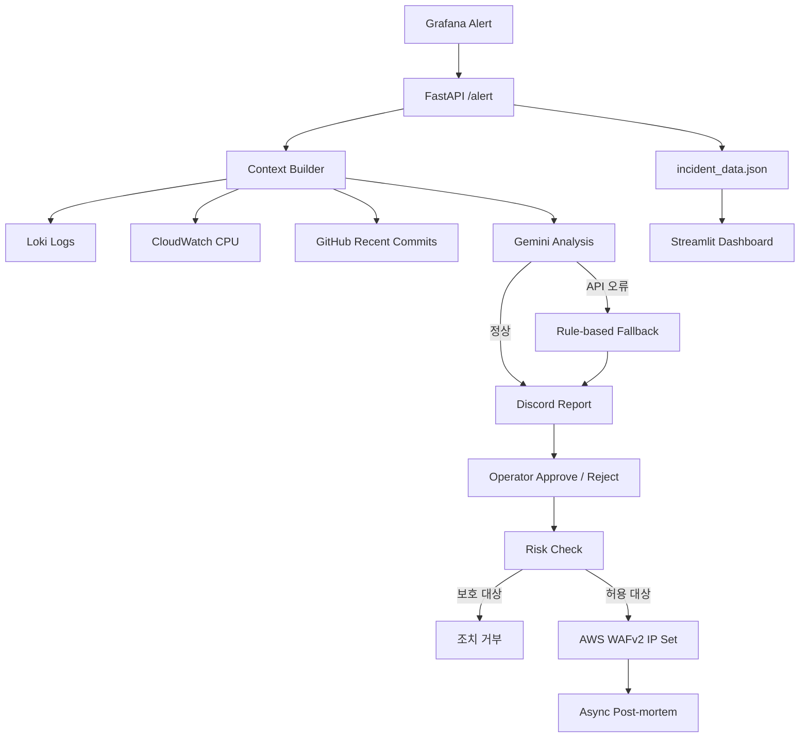

# Project 03. Bifrost

> **로그·메트릭·배포 이력을 하나의 장애 Context로 수집하고, Gemini 분석과 운영자 승인·위험 검증을 거쳐 AWS WAFv2 대응까지 연결하는 SRE/보안 운영 자동화 프로토타입입니다.**

## Project Context

이전 [Heimdall 프로젝트](https://github.com/Hoit1210/Heimdall-project)에서는 외부 AI API와 데이터 흐름에 대한 통제를 강화했습니다. 하지만 운영 과정에서 로그, CPU 메트릭, 코드 변경 이력이 서로 분리되어 있어 장애 발생 시 운영자가 원인을 연결해 판단해야 하는 문제가 남았습니다.

Bifrost는 **알림 수신 → 관련 정보 수집 → AI 기반 원인 후보 분석 → 사람의 승인 → 위험 확인 → 제한된 조치 → 사후 기록** 흐름으로 이 문제에 접근했습니다.

**중요한 설계 원칙:** AI가 인프라 변경을 직접 결정하지 않습니다. AI는 분석을 제안하고, 운영자가 승인하며, 정책 검증을 통과한 조치만 시도합니다.

## Architecture



상세 설계: [Architecture](docs/architecture.md)

## Tech Stack

| 구분 | 기술 | 목적 |
|---|---|---|
| API / Orchestration | Python, FastAPI | 알림 수신과 대응 흐름 제어 |
| Observability | Grafana, Loki, Amazon CloudWatch | 알림·로그·메트릭 수집 |
| Change Context | GitHub API | 최근 커밋 이력 수집 |
| AI Analysis | Gemini API | 장애 원인 후보와 대응 권고 |
| Operator Interface | Discord | 보고와 승인/거부 |
| Remediation | AWS WAFv2 IP Set | 승인된 IP 기반 통제 |
| Dashboard | Streamlit | 최신 Incident Context 조회 |

## Core Engineering Decisions

| 운영 문제 | 설계 선택 | 이유 |
|---|---|---|
| 단일 알림만으로는 판단 어려움 | Context Builder | 여러 운영 신호를 함께 제공 |
| AI 오판이 인프라 변경으로 이어질 위험 | Human-in-the-loop | 최종 판단을 운영자에게 유지 |
| 사람도 잘못된 대상을 승인할 수 있음 | Risk Check | 사설/보호 IP 대역 차단 |
| 외부 LLM 장애 | Rule-based Fallback | 분석 품질은 낮아져도 흐름 중단 방지 |
| 반복적인 장애 보고 작성 | Async Post-mortem | 승인 처리와 후속 기록 분리 |

## Implementation & Validation

### 1. 장애 알림과 Context 수집
- `/alert`가 Grafana 호환 Payload를 수신합니다.
- Loki 로그, CloudWatch EC2 CPU 메트릭, GitHub 최근 커밋을 Context로 모읍니다.
- 최신 Incident Snapshot은 `incident_data.json`에 기록하고 대시보드에서 표시합니다.
- 서로 다른 신호를 함께 제공하지만, 이 자체가 **장애 원인을 확정적으로 증명하는 것은 아닙니다.**

### 2. AI 분석과 장애 대응 지속성
- Gemini가 장애 원인 후보(RCA)와 조치 권고를 작성합니다.
- API 호출에 실패하면 규칙 기반 Fallback을 사용합니다. Fallback은 운영 흐름 유지를 위한 것이며 Gemini와 동일한 분석 정확도를 보장하지 않습니다.

### 3. 운영자 승인과 안전 검증
- Discord 보고에 승인/거부 URL을 포함합니다.
- 승인 후에도 `is_protected_ip()`에서 사설 주소·Whitelist 대상을 확인해 보호 대상이면 조치를 거부합니다.
- 통과한 대상에 한해 AWS WAFv2 IP Set 갱신을 시도합니다. 실제 차단 효과는 해당 IP Set의 WAF 연결과 설정에 따라 달라집니다.

### 4. 대시보드 / 사후 보고
- Streamlit은 최신 알림, 대상 IP, CPU 메트릭, 분석 내용, 로그, 배포 이력, 대응 상태를 표시합니다.
- 조치 후 별도 비동기 흐름으로 Discord에 Incident Timeline 및 결과를 전달합니다.

### 5. Kubernetes 복구 검증 범위
- `/eks-alert`는 **시뮬레이션한 Pod 장애 이벤트**를 수신하는 고급 검증용 Endpoint입니다.
- 실제 Pod 교체·복구는 Kubernetes 기본 Controller가 담당합니다. Bifrost가 직접 EKS를 복구했다고 주장하지 않습니다.

## Troubleshooting

| 문제 | 대응 | 확인할 점 |
|---|---|---|
| Gemini `503 UNAVAILABLE` | 규칙 기반 Fallback | 분석 수준 저하를 명시 |
| Loki 응답이 비어 있거나 JSON 파싱 실패 | 상태·응답 확인, 예외 처리 | 전체 Incident Pipeline 중단 방지 |
| Discord Markdown 승인 링크 사용성 문제 | 원시 URL 사용 | 실서비스에서는 인증·서명된 승인 방식 필요 |

상세 내용: [Troubleshooting](docs/troubleshooting.md)

## Repository Structure

```text
main.py                    # API 및 대응 파이프라인
dashboard.py               # Streamlit Dashboard
scripts/                   # 통제된 장애/공격 이벤트 시뮬레이션
docs/                      # 아키텍처 및 Troubleshooting
requirements.txt
.env.example
SECURITY.md
README.md
```

## Run & Validation

```bash
cp .env.example .env
pip install -r requirements.txt
uvicorn main:app --host 0.0.0.0 --port 8000
```

별도 터미널에서:

```bash
streamlit run dashboard.py
```

시뮬레이션 예제:

```bash
python scripts/red_team_simulation.py
python scripts/eks_event_simulation.py
```

> Red-Team 스크립트는 문서용 주소(`203.0.113.50`)를 사용하는 **모의 이벤트 전송**으로 실제 공격을 수행하지 않습니다. 실행에 필요한 외부 연동·환경 변수는 각자 설정해야 합니다.

## Security & Limitations

- 현재 승인 URL은 **프로토타입**으로, 프로덕션 적용 전 HTTPS·인증·권한 확인·서명/만료·재전송 방지가 필요합니다.
- IP/대역 기반 Risk Check는 자산 소유권, 서비스 중요도 등을 판단하는 완전한 정책 엔진이 아닙니다.
- `incident_data.json`은 로컬 단일 노드 상태 저장소로, 영속적·고가용성 Incident DB가 아닙니다.
- WAF 기반 대응은 IP Set을 이용하는 제한된 조치이며 범용 자동 복구 플랫폼이 아닙니다.
- 비밀값, Webhook Token, AWS Access Key 및 실제 운영 식별자는 공개하지 않습니다. [SECURITY.md](SECURITY.md) 참고.

## Portfolio & Next Step

[Project 03 Bifrost Notion Portfolio](https://app.notion.com/p/Bifrost-AI-SRE-3ac59c94122580c8a70fd95e76cf7b71)

**Project 01 BUILD → Project 02 SECURE → Project 03 OBSERVE & RESPOND → [Project 04 AUTOMATE](https://github.com/Hoit1210/SRE_project)**

> Bifrost에서는 여러 운영 신호를 연결해 장애에 대응했습니다. 다음 프로젝트에서는 Terraform·GitHub Actions·컨테이너 Health Check를 이용한 인프라 배포 및 복구 작업 자동화를 다룹니다.


---

## 실제 구축·검증 증거 (Notion 연계)

**[개인 프로젝트 관리 — Project 03 Bifrost](https://app.notion.com/p/3b059c94122580edb20ccda52d769de7)**에 실제 단계별 구현 결과와 화면 캡처가 있습니다.

| 구현 단계 | 노션에 기록된 확인 내용 | 확인할 위치 |
|---|---|---|
| 이벤트 수신 | Grafana Alert → FastAPI Webhook 이벤트 전달 | Architecture Evolution / Context-Aware Incident Pipeline |
| 운영 데이터 연결 | Loki Log + CloudWatch CPU + GitHub Commit History 수집 | Context Builder |
| AI 분석 | Gemini 기반 원인 후보 및 Action Item 제안 | AI Incident Analysis |
| 조치 통제 | Discord 승인·거부, 보호 대상 Risk Check, WAF IP Set 갱신 흐름 | Safe Remediation & Risk Control |
| 실제 장애 대응 예시 | SSH Brute Force **모의 이벤트**부터 WAF 조치 결과까지 Incident Timeline | Result → End-to-End Incident Lifecycle |
| 시각화 | Streamlit 화면에서 최근 알림·분석·대응 상태 확인 | Result → Bifrost Dashboard |
| 예외 처리 | Gemini 503, Discord 링크, Loki 응답 오류 사례 | Reliability & Troubleshooting |

### 클라우드 구성 관점

위의 Mermaid 구성도는 **AWS CloudWatch/WAFv2와 외부 서비스(Grafana, Loki, GitHub, Gemini, Discord)를 FastAPI가 연계하는 처리 흐름**을 나타냅니다. 완전한 자동 보안 통제나 무인 운영을 의미하지 않습니다. WAF 조치는 운영자 승인과 위험 검사를 거치며, 테스트용 이벤트와 실제 공격을 구분합니다.

**검증 화면은 노션 원본에 보관합니다.** GitHub에는 코드와 재현에 필요한 설정, 연동 구조를 기록합니다.
