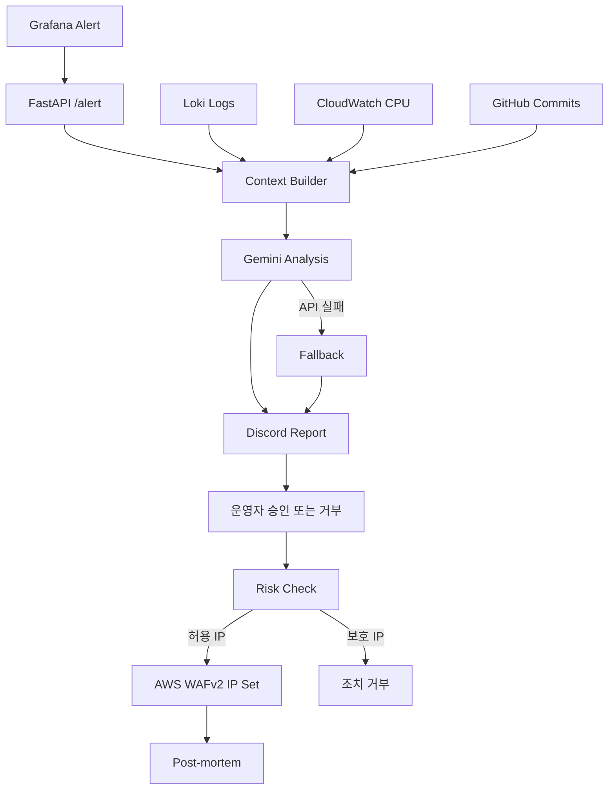

# Bifrost 설계

## 처리 흐름

## 구성 요소별 역할

FastAPI는 알림 수신과 전체 요청 흐름을 연결합니다. Context Builder는 Loki 로그, CloudWatch CPU 메트릭, GitHub 최근 커밋을 가져옵니다. 이 정보를 모았다고 해서 장애 원인이 확정되는 것은 아닙니다.

Gemini는 원인 후보와 권장 조치를 제안합니다. API 오류가 나면 규칙 기반 메시지로 처리 흐름을 유지합니다.

Discord는 분석 결과와 승인·거부 URL을 전달합니다. 최종 조치는 운영자가 판단하며, 승인 이후에도 Risk Check를 통해 사설망 및 보호 대역을 확인합니다.

WAFv2 IP Set은 허용된 IP에 대한 조치를 적용하는 경로입니다. IP Set에 추가했다고 모든 환경에서 즉시 차단된다고 단정할 수 없으며 WAF 연결 여부가 중요합니다.

Streamlit은 로컬 `incident_data.json`에서 가장 최근 사건 정보를 읽어 보여 줍니다.

## Kubernetes 연동 범위

`/eks-alert`는 Pod 장애 시뮬레이션 이벤트를 받는 검증용 API입니다. Pod의 교체·복구는 Kubernetes Controller가 담당합니다. Bifrost가 직접 Pod를 복원하는 구조는 아닙니다.

## 보완할 부분

현재 승인 링크는 시제품 방식입니다. 외부 공개 전에 인증·인가, HTTPS, 링크 서명 및 만료 처리가 필요합니다. 사건 기록도 단일 로컬 파일이므로 서버 장애에 대비한 영속 저장소는 별도로 필요합니다.

[실제 검증 화면 및 작업 기록](https://app.notion.com/p/3b059c94122580edb20ccda52d769de7)
