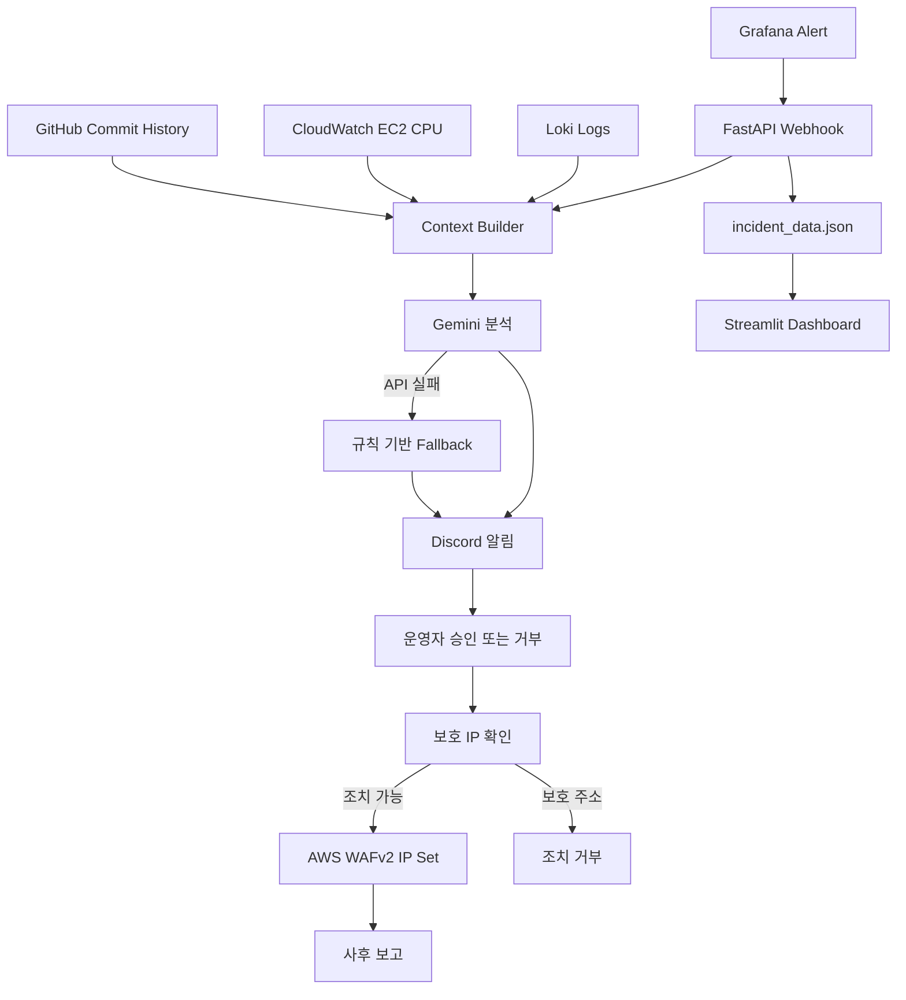

# 아키텍처

Bifrost는 발생한 장애 이벤트를 분석하고, 승인 절차를 거쳐 제한적인 AWS WAF 조치를 수행하는 서비스입니다.

AI가 제안한 내용을 바로 AWS에 적용하지 않고 승인과 IP 검사를 거치도록 설계했습니다. WAF IP Set을 변경하는 것과 실제 트래픽 차단 효과는 구분해야 합니다. WAF 연결 방식에 따라 동작 범위가 달라집니다.

[구현 및 검증 기록](https://app.notion.com/p/3b059c94122580edb20ccda52d769de7)에는 대시보드, 테스트 이벤트, Discord 보고, 장애 처리 흐름을 정리했습니다. 테스트 이벤트를 실제 침해 사고라고 표현하지 않습니다.
