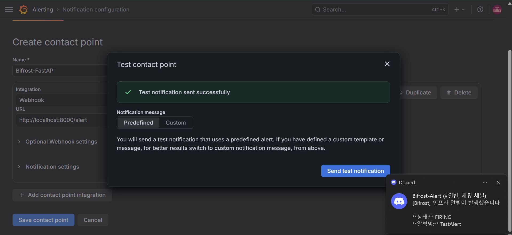
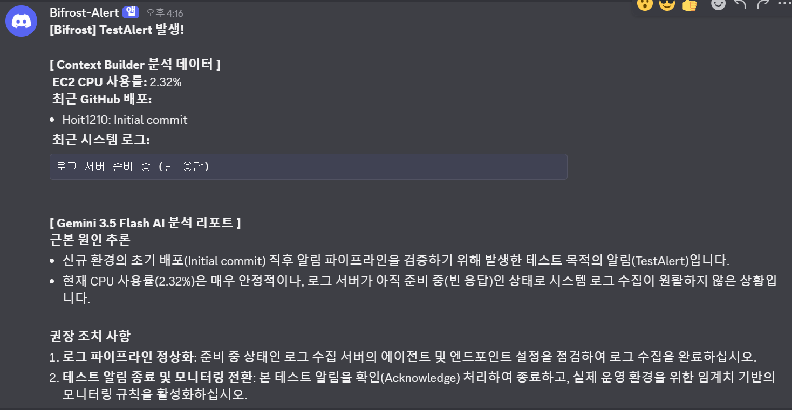
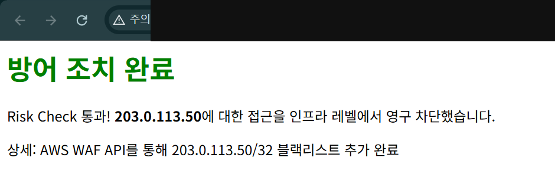
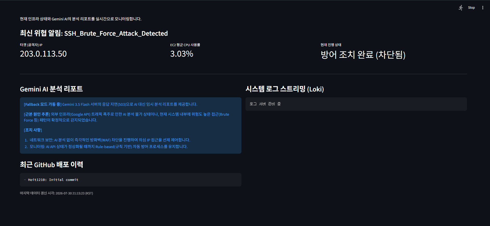
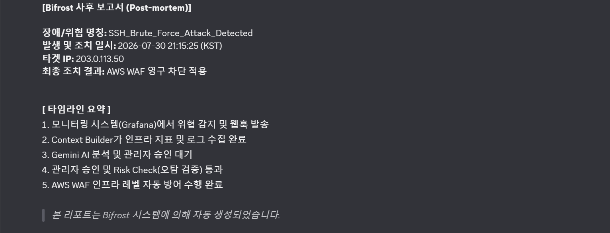

# 구축 및 검증 화면

프로젝트 진행 당시 노션에 보관한 실행 화면입니다. 캡처에서 확인할 수 있는 결과를 중심으로 정리했습니다. 현재 서비스를 다시 실행해 검증한 기록은 아닙니다.

공개용 사본에는 AWS 계정 식별자, 공인 IP, 인증 토큰 등 노출을 피해야 하는 부분을 불투명하게 가렸습니다. localhost·루프백 주소와 문서용 테스트 주소는 유지했습니다.

`203.0.113.50`은 모의 이벤트에 사용한 문서용 주소입니다. 화면의 ‘영구 차단’ 문구는 애플리케이션의 결과 표시이며 실제 공격 차단을 입증하지 않습니다.

## Grafana 알림 전달

Grafana의 테스트 알림 전송 성공 메시지와 Discord 알림 수신 화면입니다.

## CPU·커밋 정보와 로그 빈 응답

CPU 사용률과 최근 커밋 정보가 보고서에 표시됩니다. 이 시점의 로그는 빈 응답이므로 정상 로그 수집의 증거로 해석하지 않습니다.

## 승인 후 WAF 조치 결과 응답

승인 요청 후 애플리케이션이 WAF IP Set 추가 완료를 표시한 화면입니다. 이 화면만으로 WAF 연결 상태나 실제 트래픽 차단 효과까지 확인할 수는 없습니다.

## Streamlit 대시보드

Streamlit에 대상 IP, CPU, 대응 상태와 분석 결과가 표시됩니다. 화면의 분석은 Gemini 503 오류에 따른 규칙 기반 Fallback이며 로그 영역은 준비 중 상태입니다.

## 장애 대응 타임라인

모의 이벤트의 감지·승인·조치 흐름을 정리한 자동 생성 사후 보고서입니다. 독립된 WAF 감사 로그를 대신하지 않습니다.

[프로젝트 설명으로 돌아가기](../README.md)
